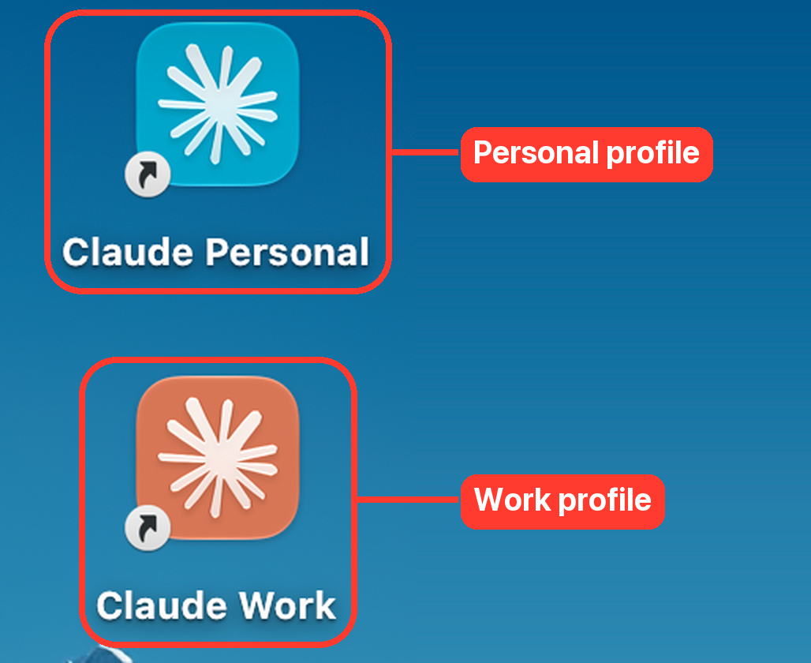
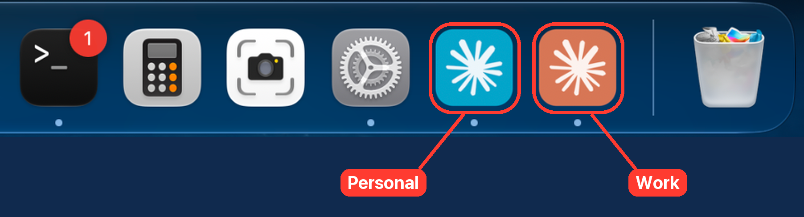

# Claude Profiles for macOS

Run separate, fully isolated Claude Desktop and Claude Code profiles (for example, Work and Personal) on one Mac. Each profile has its own login, chats, settings, projects, connectors, and Claude Code configuration, plus its own logo, Spotlight launcher, and Desktop shortcut.

> This uses Electron's `--user-data-dir` flag and Claude Code's `CLAUDE_CONFIG_DIR` environment variable. It is a community workaround, not an officially supported Claude feature.

## Screenshots

Each profile gets its own Desktop shortcut and logo:



Both profiles can run side by side, each with its own icon in the Dock:



## Disclaimer

This is an unofficial, open-source community project. It is not affiliated with,
endorsed by, sponsored by, or supported by Anthropic.

"Claude" and the Claude logo are trademarks of Anthropic. They are used here
only to describe the software this project works with. No logos or other Anthropic
brand assets are included in this repository; any logos you use are your own.

This project relies on undocumented behavior (Electron's `--user-data-dir` flag and
Claude Code's `CLAUDE_CONFIG_DIR` environment variable) and may stop working if
Claude Desktop or Claude Code changes. It does not modify your original Claude
installation, but it does copy it and move it to a different folder.

You are responsible for using Claude in line with Anthropic's terms of service and
usage policies, including any rules about multiple accounts.

This software is provided "as is," without warranty of any kind. Use at your own risk.

## What is in the package

```
claude-profiles/
  setup.sh                    The setup script
  claude-icon-work.png        Logo for the Work profile
  claude-icon-personal.png    Logo for the Personal profile
  README.md                   This file
  screenshots/                Images used in this README
```

Logos are optional. A profile without a matching `claude-icon-<profile>.png` (or `.icns`) keeps the standard Claude icon. Use square images, ideally 1024×1024.

The script automatically shrinks PNG logos onto Apple's icon grid (824×824 artwork centered on a 1024×1024 transparent canvas), so they match the size of other Dock icons. If your PNG already includes that padding, run with `--no-icon-pad`. `.icns` files are used as-is.

## Requirements

- macOS
- Claude Desktop installed normally in `/Applications` (download from claude.ai/download)
- Claude Code installed, if you want to use the CLI aliases

## Setup

1. Extract the folder (for example, into `~/Downloads`).
2. Open Terminal, go to the folder, and make the script executable:

   ```bash
   cd ~/Downloads/claude-profiles
   chmod +x setup.sh
   ```

3. Run the script. By default, both profiles start fresh. To carry your current Claude login and chats into one profile, add `--migrate-to`:

   ```bash
   ./setup.sh                          # both profiles start fresh (default)
   ./setup.sh --migrate-to work        # current login goes to Work
   ./setup.sh --migrate-to personal    # current login goes to Personal
   ```

4. Open a new Terminal window, or run `source ~/.zshrc`, to load the aliases.
5. Launch from the **Claude Work** or **Claude Personal** shortcut on your Desktop, or press ⌘Space and type the name.

The first time a launcher focuses an already-running window, macOS asks to let it control System Events. Approve it in System Settings > Privacy & Security > Automation (and Accessibility, if prompted).

## What the script does

1. **Hides the original app.** Quits Claude if it is running, then moves `/Applications/Claude.app` to `~/Applications/.claude-clones/Claude.app`, where Spotlight and Launchpad do not see it.
2. **Migrates your existing login (only with `--migrate-to`).** Copies your current Claude Desktop data and `~/.claude` folder into the chosen profile. This is a copy; the originals are left in place. It is skipped if that profile already has data. Without the flag, nothing is migrated and each profile asks you to sign in.
3. **Builds each profile:**
   - `~/.claude-<name>/desktop` for Claude Desktop data
   - `~/.claude-<name>/code` for Claude Code configuration
   - `~/.claude-<name>/launch.sh` with the focus-or-launch logic
   - `~/Applications/.claude-clones/Claude <Name>.app`, a copy of Claude with your logo
   - `~/Applications/Claude <Name>.app`, the Spotlight launcher (it has no Dock icon of its own)
4. **Adds Desktop shortcuts.** Puts a **Claude Work** and **Claude Personal** shortcut on your Desktop, showing each profile's logo. Double-click to launch. Skip this with `--no-desktop`.
5. **Turns off Claude's built-in updater and installs a watchdog.** Claude's own updater replaces the app and relaunches it *without* the profile flag, which opens the default account (for example, Personal inside the Work app). Setup writes `disableAutoUpdates` to `/Library/Managed Preferences/com.anthropic.claudefordesktop.plist` (asks for your admin password; skip with `--keep-auto-update`). A LaunchAgent (`~/.claude-profiles/watchdog.sh`) also checks every few seconds for a profile app running without its profile, quits it, and relaunches it correctly.
6. **Adds aliases** to `~/.zshrc` inside a marked block, so reruns replace them instead of duplicating them.

## Aliases

| Alias | What it does |
| --- | --- |
| `claude-work` | Starts Claude Code (CLI) in the Work profile |
| `claude-personal` | Starts Claude Code (CLI) in the Personal profile |
| `claude-work-app` | Opens or focuses the Work desktop app |
| `claude-personal-app` | Opens or focuses the Personal desktop app |

## Launching

Every launch through a shortcut, launcher, or `-app` alias:

1. Checks claude.ai for the latest Claude release and, if it is newer, downloads it and verifies Anthropic's code signature.
2. Rebuilds that profile's app copy when the version changed or its logo is missing. macOS will not let anything change the icon of an app that has already been launched, but a fresh copy accepts it, so the copy is rebuilt rather than patched.
3. Quits that profile's app if it is running without its profile flag, and quits the hidden base copy (it has no profile, so it opens the default account).
4. Throws away any update staged by Claude's built-in updater, which would otherwise install on quit and relaunch without the profile.
5. Focuses the existing window, or launches with the profile and confirms it started with the right data folder. If an update is waiting while the profile is open, it asks before restarting.

## Troubleshooting

- **A profile shows a plain folder icon.** Claude's built-in updater replaced the app but left its "custom icon" flag behind. Launch from the shortcut once; the copy is rebuilt with its logo. If it still has no logo, see `~/.claude-<name>/launch.log`.
- **A profile opened the other account.** Usually Claude's built-in updater relaunched it. Rerun `./setup.sh` so the updater is turned off and the watchdog is running (`launchctl print gui/$UID/com.claude-profiles.watchdog`).
- **Signing in.** Sign-in returns to the app through a `claude://` link, and macOS sends it to whichever Claude copy it picks. Quit the other profiles before you sign in to a profile.

Everything is logged in `~/.claude-<name>/launch.log`.

Always launch through the Desktop shortcuts, Spotlight, Launchpad, the launchers in `~/Applications`, or the `-app` aliases. These pass the profile settings to Claude.

Avoid opening anything inside `~/Applications/.claude-clones` directly, and do not choose **Options > Keep in Dock** on a running Claude icon. Both start Claude without the profile flag, which opens the default, unseparated profile.

If you pin a launcher to the Dock, you will see two icons while that profile runs (the launcher and the running app). This is a macOS limitation, because they are separate apps. Launching from Spotlight keeps the Dock to one icon per profile.

## Updating Claude

Automatic: launching a profile installs the latest release (see **Launching**). Your logins, chats, and settings are not affected. If Claude ever asks to move itself back to the Applications folder, decline.

If you install Claude into `/Applications` yourself, run `./setup.sh` again so it is hidden and used as the base copy.

## Options

| Option | What it does |
| --- | --- |
| `--migrate-to <profile>` | Copies your current Claude login, chats, and `~/.claude` into that profile (default: no migration) |
| `--no-desktop` | Does not put shortcuts on the Desktop |
| `--no-icon-pad` | Uses PNG logos as-is instead of padding them to Apple's icon size |
| `--keep-auto-update` | Leaves Claude's built-in updater on (not recommended; the watchdog still corrects the relaunch) |
| `profile ...` | Profiles to create (default: `work personal`) |
| `-h`, `--help` | Shows usage |

Examples:

```bash
./setup.sh --migrate-to work
./setup.sh --migrate-to personal
./setup.sh --migrate-to work --no-desktop
./setup.sh work personal clientx --migrate-to clientx
```

The `--migrate-to` profile must be one of the profiles being created.

## Customizing

- **Different or extra profiles:** pass names as arguments, for example `./setup.sh work personal clientx`, with a logo named `claude-icon-clientx.png`.
- **Change a logo:** replace the PNG in this folder and rerun the script.

## Troubleshooting

| Problem | Fix |
| --- | --- |
| A launcher or clone will not open after a logo change | Re-sign it: `codesign --force --deep -s - ~/Applications/Claude\ Work.app` |
| Icons look outdated | Run `killall Finder Dock` |
| A profile's logo reverts to the standard icon or a folder | Quit that profile and open it from its shortcut; the launcher rebuilds the copy with the logo. See `~/.claude-<name>/launch.log` |
| A profile opened in the wrong account | Something started it without its profile. The watchdog should catch this within seconds; check `~/.claude-profiles/watchdog.log`, and that `launchctl print gui/$UID/com.claude-profiles.watchdog` shows it running |
| Icons look too big or too small next to other Dock icons | Adjust `ICON_ART` near the top of `setup.sh` (default `824`; lower is smaller) and rerun |
| A second window opens instead of focusing the existing one | Approve the Automation and Accessibility prompts for the launcher |
| `Claude.app not found` | Install Claude into `/Applications` and rerun |
| Desktop shortcut was skipped | Something else named "Claude Work" or "Claude Personal" is on the Desktop; rename it and rerun |
| Aliases not found | Open a new Terminal window or run `source ~/.zshrc` |
| `permission denied: ./setup.sh` | Run `chmod +x setup.sh` first, or run it as `zsh setup.sh` |
| Migrated to the wrong profile | Quit Claude, delete that profile's `desktop` and `code` folders, and rerun with the right `--migrate-to` (your original data is still in `~/Library/Application Support/Claude` and `~/.claude`) |
| Want to migrate after setup | Quit that profile, delete its `desktop` and `code` folders, and rerun with `--migrate-to <profile>` |

## Uninstalling

```bash
osascript -e 'quit app "Claude"'
mv ~/Applications/.claude-clones/Claude.app /Applications/
rm -rf ~/Applications/.claude-clones
rm -rf ~/Applications/Claude\ Work.app ~/Applications/Claude\ Personal.app
rm -f ~/Desktop/Claude\ Work ~/Desktop/Claude\ Personal
sed -i '' '/# >>> claude-profiles >>>/,/# <<< claude-profiles <<</d' ~/.zshrc
launchctl bootout gui/$UID/com.claude-profiles.watchdog
rm -rf ~/.claude-profiles ~/Library/LaunchAgents/com.claude-profiles.watchdog.plist
sudo /usr/libexec/PlistBuddy -c "Delete :disableAutoUpdates" "/Library/Managed Preferences/com.anthropic.claudefordesktop.plist"
```

Your profile data stays in `~/.claude-work` and `~/.claude-personal`. Delete those folders only if you no longer need the logins, chats, and settings inside them.
